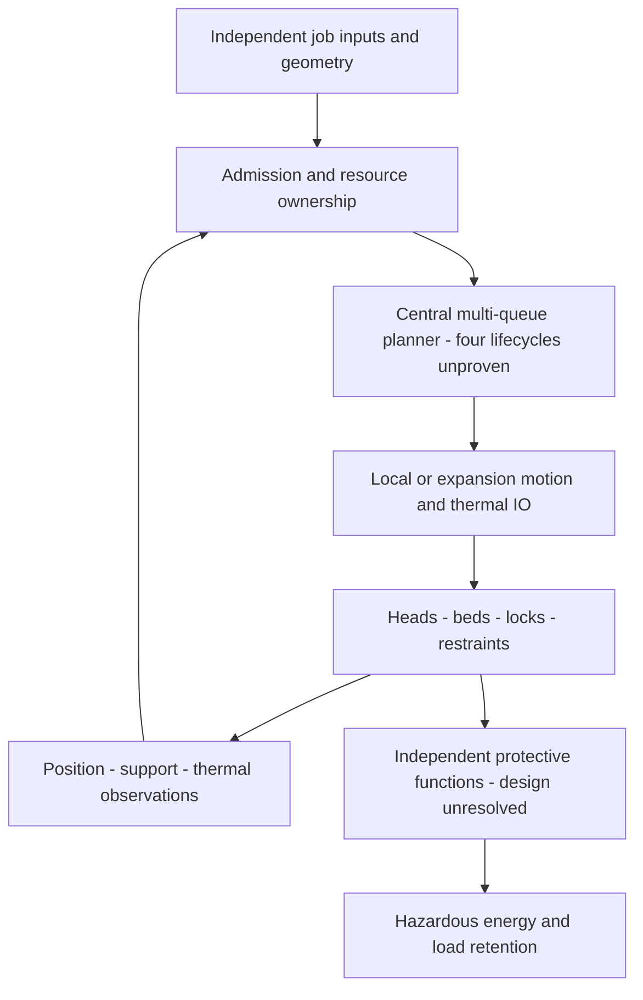
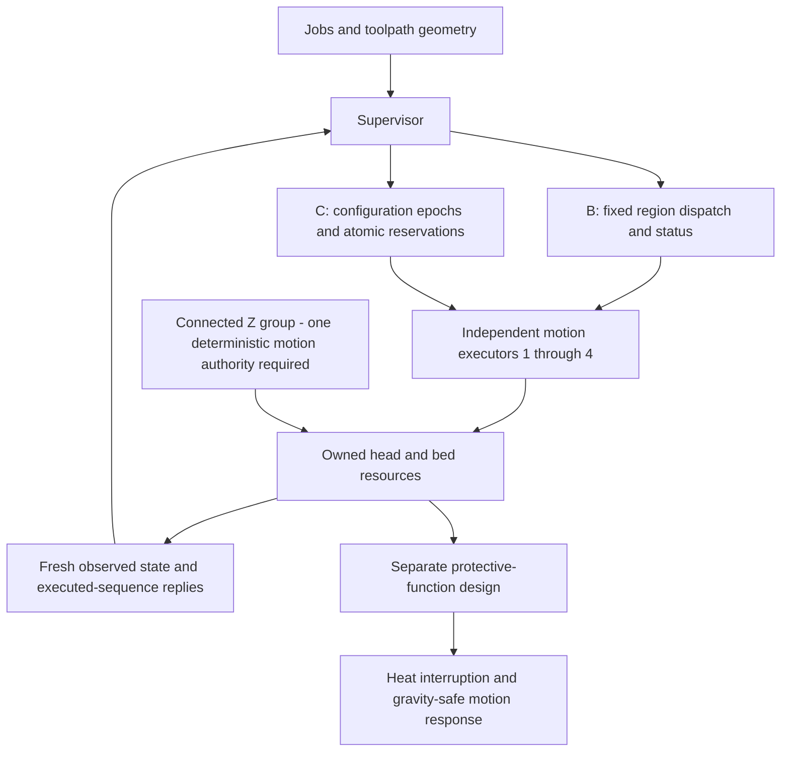
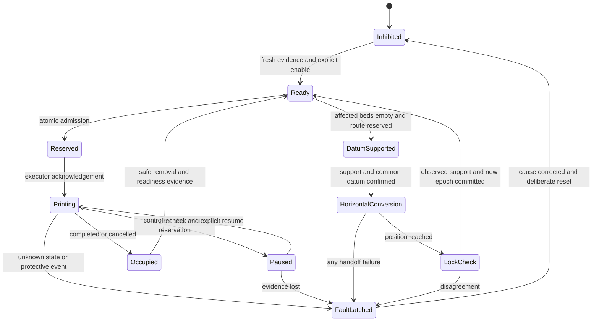
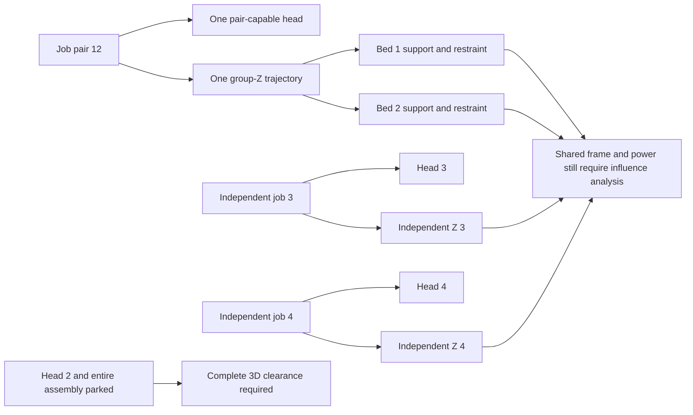

# D6 — editable conceptual control diagrams

Original Mermaid source, controller-independent, **not wiring, implemented architecture,
physical clearance or a validated protective system**. Arrows are information/authority
relationships, not selected buses. [Study](d6-engineering-study.md).

## A — centralized execution

## B and C — distributed execution, different coordination scope

An executor is not necessarily one board. A connected Z group cannot receive unrelated
trajectories from several owners; changing ownership requires empty affected beds,
retained support and a new verified configuration. Neither USB nor CAN implies a safety
bus. Separate processors can still share a failing host, power supply, ground or sensor.

## Proposed grouping sequence and fault latch

Fault transitions apply to every operational state even where omitted for readability.
No automatic fault-to-print arrow exists. This diagram describes the future contract;
the Python kernel collapses conversion into one abstract atomic transition.

## Independent job ownership and physical coupling

The example is M12 only. Reflecting it does not validate M34/M13/M24 geometry. A common
frame may transmit disturbances even though the resource graph has no shared actuator.
