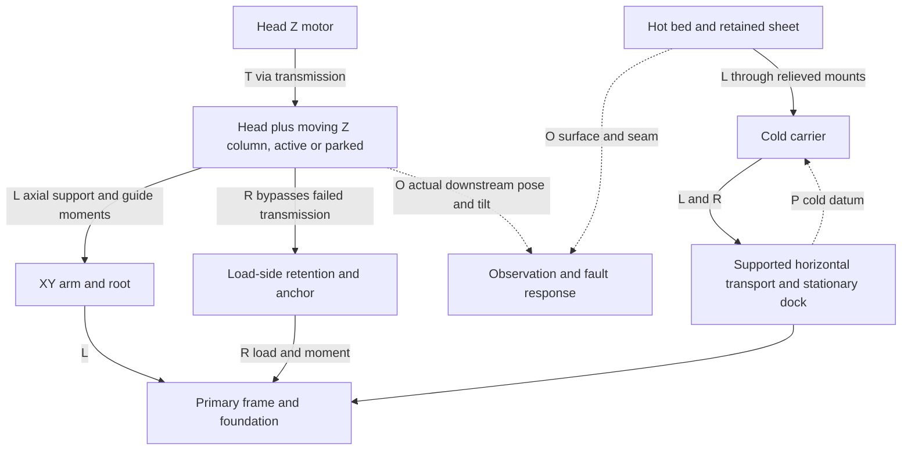
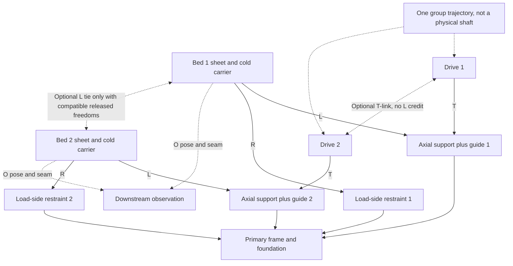
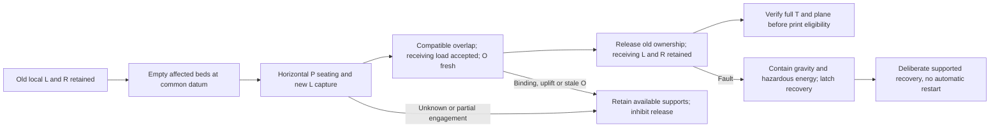

# D9 — editable load-path and handoff diagrams

[Contract](d9-contract.md) · [faults](d9-faults.md).
Conceptual Mermaid/text source; no dimensions, component selection or CAD geometry.
Arrows identify functions, not proven contact capacity or physical independence.
X east, Y north, Z up; beds 1 NW, 2 NE, 3 SW, 4 SE.

## H: stationary bed, full-range head Z



R is separate from the broken T element, but the drawing does not establish anchor
independence: a shared printed root or foundation fault can defeat both arrows.
Horizontal bed conversion remains at z=0 with continuous transport support. H parks
still carry complete head/column mass, cable force and catching moments.

## B: E-sync and separately optional hybrid / transmission tie



P locates each carrier in its moving assembly, or uses a separately analyzed released
follower datum. The dashed optional edges are alternatives, not simultaneous mandatory
parts of E-sync. Fixed-Z heads still return their weight/moments through drop structures
and arms to the frame. Other beds/heads/platforms are omitted for legibility only;
the inventory in the contract retains them.

## Eight group graphs

Each bracket is an independent height owner, not one physical lift. Every bed has L/R
irrespective of whether it is connected to another bed for P, T or optional L.

```text
S     [1] [2] [3] [4]        R     [1--2] [3--4]
C     [1--3] [2--4]          M12   [1--2] [3] [4]
M34   [3--4] [1] [2]         M13   [1--3] [2] [4]
M24   [2--4] [1] [3]         J     [1--2, 1--3, 3--4]
```

J's displayed spanning tree describes scalar equality or a possible T tree only.
It does not establish a statically determinate six-DOF support structure. H realizes
these job coordinates in head lifts; B realizes them in descending bed groups.

## Optional F-group J support transfer and fault logic



Receiving path is bed → platform load locks → platform axial support/guide → frame,
with independent platform R. A platform detached in partial modes remains retained
clear of every bed stroke. C-group instead receives onto stationary J supports and
adds head/gantry Z. Neither arrangement has a designed handoff. An overlap that
requires forced vertical bed motion is a rejection, not a completed transfer.
