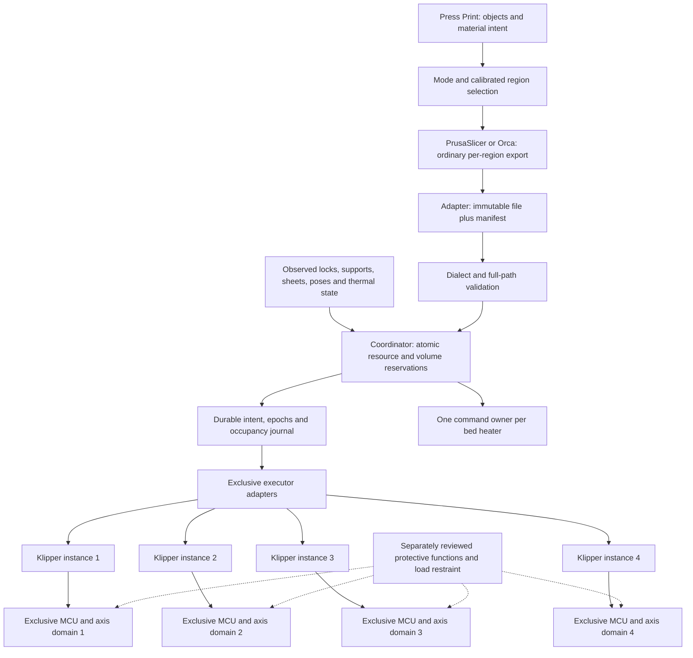
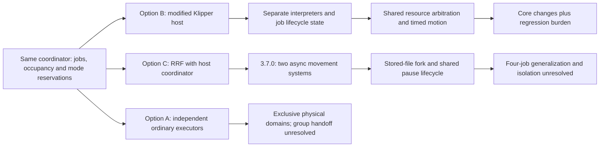

# S1 — candidate coordinator and developer interfaces

[Decision report](s1-study.md) · [source ledger](s1-sources.md).
**Proposed program boundaries; no deployed controller, protective function or selected architecture.**

## Ordinary executors with one admission authority

Executor domains are not permanently synonymous with bed numbers. H independent-head-Z
may allow fixed head executors with calibrated reach into multiple regions and a
separate thermal service owning all bed loops. Bed commands from sliced files then
must route through the thermal authority, while each nozzle stays with its executor.
Unmodified host APIs/configured heaters are potential building blocks, not a completed
atomic readiness or ownership service. No two processes may open the same MCU or race
for one physical heater/axis. Four instances on one computer retain shared host/power
failure causes.

B grouped-bed-Z is harder: beds 1/2 may change from unrelated trajectories to one
trajectory, while 3/4 must retain their live state. Network-sending the same Z command
to two instances is not a bounded synchronization design. An executor that owns every
member of the connected group, using its native timebase, is a candidate; dynamic
transfer may demand stopping/reconfiguring affected processes/MCUs, retaining loads
and re-establishing calibration. No normal hot-handoff API was established in S1.
If an MCU also controls unaffected jobs, restarting it fails this proposal. Shared
heaters/XY structures/Z drives are physical constraints, not just software locks.

## Shared scheduler alternatives

A shared planner can coordinate one group's moves against one clock, but cannot make
one shared axis follow two unrelated coordinates. Conversely, independent planners
with disjoint whole-job envelopes need not agree on layer timing. All options still
need global occupancy, thermal ownership and protected conversion. RRF asynchrony
could reduce low-level grouped-motion code; its two-system/reader/lifecycle boundaries
prevent crediting it with the complete mandatory baseline.

## Proposed interface contract

These are interface requirements, **not APIs supplied by Klipper or RRF**. Adapters
must expose unsupported semantics explicitly. Do not relabel an ordinary command ACK
as an executed-motion or sensor acknowledgement.

| Boundary | Minimum data / invariant | S1 implementation coverage |
| --- | --- | --- |
| Slicer package → coordinator | Immutable G-code hash; slicer/build/profile/dialect; requested bed group; nozzle and bed recipe; complete start/print/end/pause/park paths; units, frame/transform and mesh revisions | Synthetic dialect/profile/mesh presence and coherent per-group temperatures only; no file parser/hash/certificate |
| Planner → reservation | Head, beds, every coupled XY/Z/support/selector/park corridor and heater owner; maximum power; object and full-assembly swept volumes including uncertainty | D6 supplied AABBs, resource sets, power budget; caller supplies correctness/completeness |
| State → admission | Generation per affected domain; fresh observed position/support/locks/sheets; recipe/environment state; unknown or contradictory state inhibits | Synthetic bed generations plus D6 aggregate evidence/TTL; no sensor driver |
| Coordinator → executor | Job/session identity, epoch, immutable command sequence; prepare, commit, stop/hold, status and explicit release | Not implemented; no distributed protocol or firmware transport |
| Executor → coordinator | Accepted versus executed sequence, known pose and buffers, state/health timestamp, error/fault domain | Not implemented; file percentage is not physical progress |
| Completion/cancel → occupancy | Retain objects, stopped/parked assemblies, thermal state and reservations until independently confirmed release/removal | D6 conservatively retains whole-job reservations and supplied sweeps, even after completion |
| Restart/recovery | Durable objects/intents; new executor session and epochs; no replay of uncertain commits; explicit reconciliation and reset | In-memory fault/reset only; no crash persistence or automatic resume |

For a future production adapter, all resource preparations must succeed before start.
A lost commit acknowledgement is ambiguous: retain reservations and inhibit; query
state rather than resend a potentially executed start. Serialize admissions and bind
commands to epochs at the executor boundary, not only at UI submission. Reject
stale commands even after a mode changes away and back. Domain-specific epochs allow
an unaffected job to continue; any shared support/MCU/coordinate dependency expands
the affected domain. Domain discovery is absent from this desk model.

The coordinator owns the sole dispatch path. Disable bypassing automatic queues and
restrict direct consoles/uploads in a future deployment. An immutable admitted file
must not later acquire a global G28, M84, heater-off or mesh-reset through mutable
macros. Unsupported modal commands, scripts, firmware dialects or unknown swept paths
must reject admission. Bounding boxes of model meshes alone miss brims, purge, travel,
probe/homing, whole head/gantry, harness and retained objects.

## Protected reconfiguration and failures

```mermaid
stateDiagram-v2
    [*] --> Inhibited
    Inhibited --> Ready: fresh evidence and explicit admission authority
    Ready --> Reserved: empty affected domain and full route reserved
    Reserved --> Converting: prepared owners plus supported transfer authorization
    Converting --> Ready: observed locks, pose and calibration; new epochs
    Ready --> FaultLatched: stale evidence or executor fault
    Reserved --> FaultLatched: failed prepare or uncertain commit
    Converting --> FaultLatched: missing support or lock or position
    FaultLatched --> Inhibited: reviewed reset; retain objects until reconciled
```

A failed request before motion leaves mode and reservations intact. A physical failure
mid-conversion cannot roll back symbolically: stop/inhibit the entire influence domain,
retain positive load support and mark pose unknown. The model represents only atomic
before/after transitions and therefore cannot test this intermediate safety behavior.

Ordinary pause/cancel is job-scoped only if its path, support and thermal consequences
remain inside that job's reservation. Faults are conservatively machine-wide in S1;
future reduced scopes require mechanical/common-cause evidence. Stop latency includes
buffered commands, detection, transport, actuator response, braking and uncertainty.
No TCP/USB round-trip or command acknowledgement is a safe stopping bound. D9 positive
restraint downstream of a failed transmission remains necessary regardless of planner.
A shorted heater output is not cured by a software off command. Protective access,
service isolation and emergency-stop design need independent qualified review;
environmental-panel absence alone does not define those states.

## Offline contract scope

[s1_contract.py](s1_contract.py) imports the unchanged D6 kernel and adds admission
metadata plus bed generations. [test_s1_contract.py](test_s1_contract.py) exercises
independent lifecycles, late arrivals, partial conversions preserving unaffected jobs,
ABA stale submissions, heterogeneous group recipes, resource conflicts, J exclusivity,
park/transition collisions and fault retention. The saved trace makes differing progress
and rejected conversion visible without a printer.

It is intentionally single-threaded and in-memory. Synthetic progress mm is not nozzle
feedrate or measured height; thermal targets are metadata, not PID/heat simulation.
Synthetic strips are not D8 geometry or a fix for D8's failed envelopes. Equal target
values within a group are a conservative fixture rule, not proof of seam temperatures;
real per-sheet calibrated offsets and compatible recipe ranges remain unmodeled.
Profile/mesh names are labels, not verified calibration. Generation checks do not
implement execution-time authorization, durable epochs or a distributed transaction.
